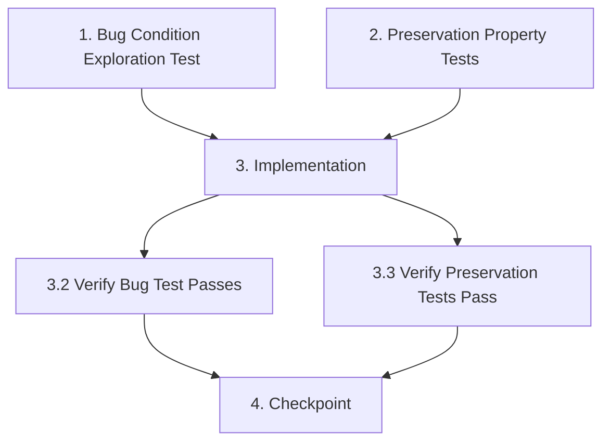

# Implementation Plan: Passive Event Listener Fix

## Overview

This implementation plan follows the exploratory bugfix workflow to fix the passive event listener warning that appears in the browser console. The fix involves replacing React's synthetic `onWheel` event with a native DOM event listener configured with `{passive: false}`.

## Task Dependency Graph



```json
{
  "waves": [
    {
      "id": 1,
      "tasks": ["1", "2"],
      "description": "Exploration and preservation testing before fix"
    },
    {
      "id": 2,
      "tasks": ["3"],
      "description": "Implement the fix"
    },
    {
      "id": 3,
      "tasks": ["4"],
      "description": "Final checkpoint"
    }
  ]
}
```

## Tasks

- [ ] 1. Write bug condition exploration test
  - **Property 1: Bug Condition** - Console Warning on Wheel Event
  - **CRITICAL**: This test MUST FAIL on unfixed code - failure confirms the bug exists
  - **DO NOT attempt to fix the test or the code when it fails**
  - **NOTE**: This test encodes the expected behavior - it will validate the fix when it passes after implementation
  - **GOAL**: Confirm passive event listener warning appears in console
  - **Scoped PBT Approach**: Scope to concrete failing case - wheel event with preventDefault on React onWheel handler
  - Test that using React onWheel with preventDefault() triggers console warning
  - Open recommendation page in browser with console monitoring
  - Trigger wheel event over canvas
  - Assert console contains warning about passive event listener
  - Run test on UNFIXED code
  - **EXPECTED OUTCOME**: Test FAILS (warning is present - this is correct and proves the bug exists)
  - Document the exact warning message found
  - Mark task complete when test is written, run, and failure is documented
  - _Requirements: Bug Condition from bugfix.md_

- [ ] 2. Write preservation property tests (BEFORE implementing fix)
  - **Property 2: Preservation** - Zoom and Pan Functionality
  - **IMPORTANT**: Follow observation-first methodology
  - Observe behavior on UNFIXED code for non-buggy inputs (mouse events, zoom buttons)
  - Write property-based tests capturing observed behavior patterns:
    - Mouse wheel zoom: for all wheel events, zoom adjusts by delta
    - Mouse drag pan: for all drag events, canvas position updates
    - Zoom buttons: for all button clicks, zoom changes by fixed increment
    - Canvas rendering: for all render events, floor plan displays correctly
  - Property-based testing generates many test cases for stronger guarantees
  - Run tests on UNFIXED code
  - **EXPECTED OUTCOME**: Tests PASS (this confirms baseline behavior to preserve)
  - Mark task complete when tests are written, run, and passing on unfixed code
  - _Requirements: Preservation 1, 2, 3, 4 from bugfix.md_

- [ ] 3. Fix for passive event listener warning

  - [ ] 3.1 Implement the fix
    - Add `svgContainerRef` using `useRef(null)` at top of component
    - Create `useEffect` hook to attach native wheel event listener
    - Move wheel handling logic from `handleCanvasWheel` into useEffect
    - Configure listener with `{ passive: false }` option
    - Add cleanup function to remove listener on unmount
    - Remove `onWheel={handleCanvasWheel}` from JSX
    - Add `ref={svgContainerRef}` to `.svg-container` div element
    - _Bug_Condition: isBugCondition(input) where input uses React onWheel with preventDefault_
    - _Expected_Behavior: No console warnings, native listener with passive:false_
    - _Preservation: Mouse events, pan, zoom buttons, canvas rendering unchanged_
    - _Requirements: Property 1, 2, 3, Preservation 1, 2, 3, 4_

  - [ ] 3.2 Verify bug condition exploration test now passes
    - **Property 1: Expected Behavior** - No Console Warnings
    - **IMPORTANT**: Re-run the SAME test from task 1 - do NOT write a new test
    - The test from task 1 encodes the expected behavior (no warnings)
    - When this test passes, it confirms the expected behavior is satisfied
    - Run bug condition exploration test from step 1
    - **EXPECTED OUTCOME**: Test PASSES (confirms bug is fixed - no console warnings)
    - _Requirements: Property 1, 2, 3 from bugfix.md Expected Behavior section_

  - [ ] 3.3 Verify preservation tests still pass
    - **Property 2: Preservation** - Zoom and Pan Functionality  
    - **IMPORTANT**: Re-run the SAME tests from task 2 - do NOT write new tests
    - Run preservation property tests from step 2
    - **EXPECTED OUTCOME**: Tests PASS (confirms no regressions)
    - Verify mouse wheel zoom still works smoothly
    - Verify mouse drag pan still works correctly
    - Verify zoom in/out/reset buttons still function
    - Verify canvas rendering is unchanged
    - Confirm all tests still pass after fix (no regressions)

- [ ] 4. Checkpoint - Ensure all tests pass
  - Ensure all tests pass
  - Open browser console and verify no passive event listener warnings
  - Test zoom with mouse wheel - should work smoothly
  - Test pan with mouse drag - should work correctly
  - Test zoom buttons - should function properly
  - Ask the user if questions arise


## Notes

- This is a low-risk fix that only affects event handling mechanism
- Zoom logic remains identical, only the event listener attachment changes
- Manual testing in browser console is sufficient to verify the fix
- No automated test framework needed - console monitoring confirms success
